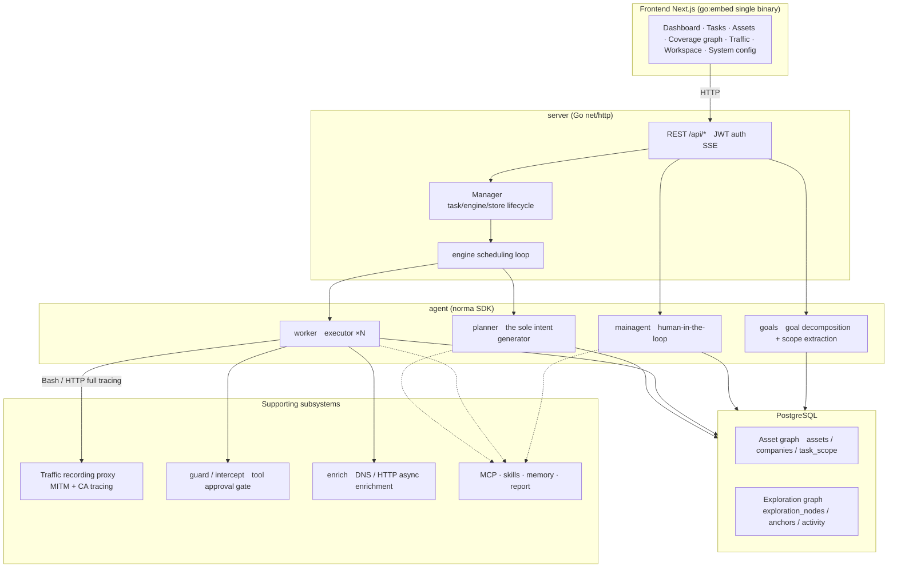
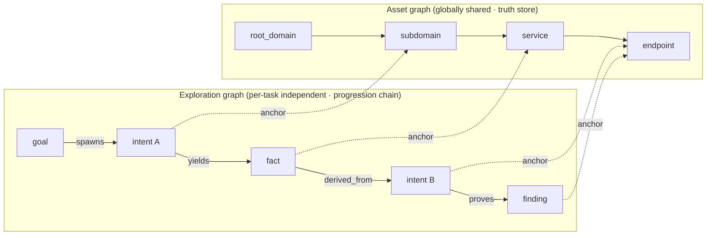
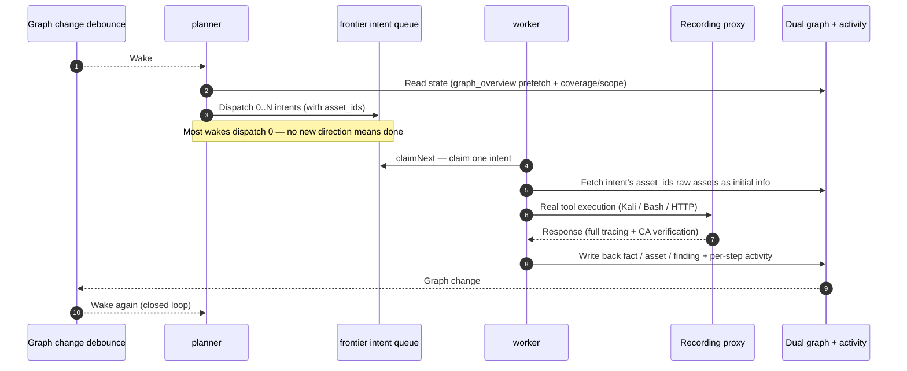
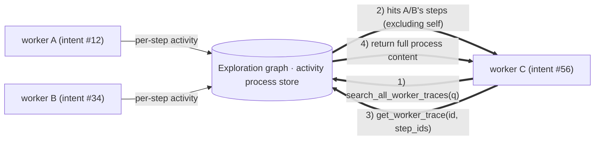
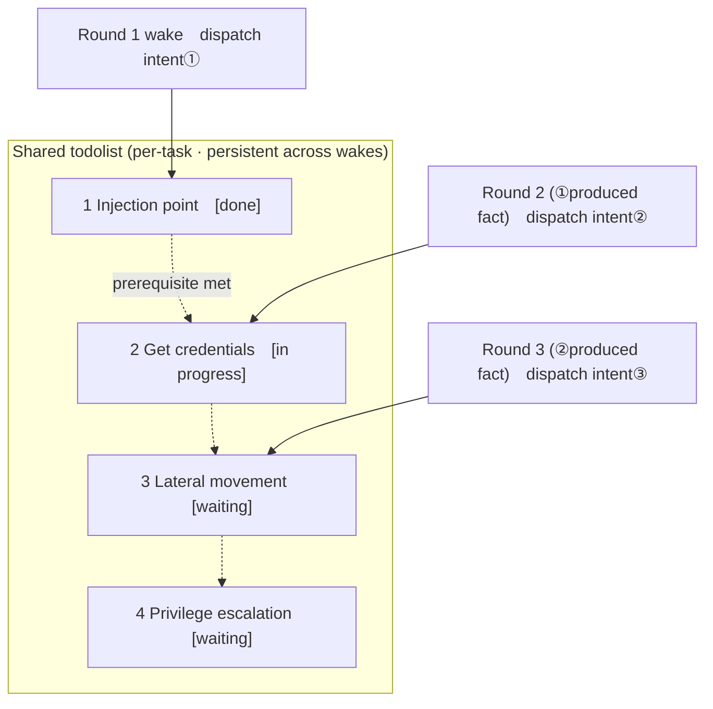

<div align="center">

# ARTEX

AI autonomous penetration testing system (Go backend + Next.js frontend)


🌐 **Online Demo**: [https://artex-demo.vercel.app/](https://artex-demo.vercel.app/)

</div>

---

## Screenshots

> Full interaction available at the [online demo](https://artex-demo.vercel.app/).

| Dashboard (overview / token usage / activity stream) | Task list |
| :---: | :---: |
|  |  |

| Task · Execution process (session / tool calls) | Exploration graph |
| :---: | :---: |
|  |  |

| Findings | Assets |
| :---: | :---: |
|  |  |

| Asset coverage graph (force-directed layout · tested highlighting · node collapse/expand) |
| :---: |
|  |

| Traffic recording | Human-in-the-loop chat |
| :---: | :---: |
|  |  |

| Agent management | LLM config |
| :---: | :---: |
|  |  |

| Intercept approval | Backend logs |
| :---: | :---: |
|  |  |


---

## Approval record details

The global "approval records", in-task "intercept approvals", and approval cards in conversations all support expanding to view details. The display structure references
[AegisHook's approval detail component](https://github.com/RuoJi6/AegisHook/blob/main/web/src/components/CallDetail.vue), using ARTEX's own components and theme:


## Asset sync (ScopeSentry)

Supports syncing asset data directly from [ScopeSentry](https://github.com/Autumn-27/ScopeSentry), eliminating redundant collection:

- On the "**Asset Sync**" page, fill in the ScopeSentry address and API Key to connect the data source;
- Select targets and asset types to sync by **project** or **task** dimension (domain / subdomain / IP / port / site / endpoint...);
- One-click import and merge by company asset scope, directly into ARTEX's asset graph for agent exploration.

---

## Installation

> Requires database **PostgreSQL**; exploration requires **LLM** configuration (`ANTHROPIC_API_KEY` or `OPENAI_API_KEY`, also configurable in the UI).

### Method 1: One-click install script (recommended)

```bash
git clone https://github.com/Hinln/ARTEX.git
cd ARTEX
./install.sh
```

The script will: detect / auto-install Docker → let you choose **① Full Docker** or **② Local build and run**:

- **① Full Docker**: Enter a Postgres password (Enter for random) → auto-write `.env` → `docker compose up -d`.
- **② Local run**: Choose database (connect existing / start one with Docker) → generate `config.json` → `go` compile embedded single binary → start.

After installation, open **http://localhost:8787** (first visit goes to `/setup` to set admin password).

### Method 2: Docker Compose (manual)

```bash
git clone https://github.com/Hinln/ARTEX.git
cd ARTEX
cp .env.example .env          # Fill in POSTGRES_PASSWORD, optional ANTHROPIC_API_KEY
docker compose up -d          # Pull autumn27/artex image + postgres
# → http://localhost:8787
```

The image includes common tools (ripgrep/curl/vim/npm/nmap...); `./skills` and `./data` are persisted via bind mounts.

Remote MCP can be configured in system settings as `http` (Streamable HTTP) or `sse` (legacy SSE).
Legacy SSE services typically use `GET /sse` to establish an event stream, then accept JSON-RPC requests via
`/message?sessionId=...` returned by the service; set the URL to `/sse` and the request header to
`Authorization=Bearer <token>`.

### Method 3: Download pre-compiled binary (Releases)

Go to [Releases](https://github.com/Hinln/ARTEX/releases) and download the zip for your platform. After extraction you get `artex` + `start.sh` (or `start.bat` on Windows) + `skills/` + `config.example.json`:

```bash
cp config.example.json config.json   # Fill in database connection
./start.sh                           # → http://localhost:8787
```

> Please use `start.sh` / `start.bat` to launch, not `./artex` directly. It's a daemon script: after the program exits, it decides whether to restart based on the exit code. **The [one-click update](#method-1-page-one-click-update-recommended) on the page relies on it for hot-swapping.** Running `./artex` directly means the updated binary won't be relaunched after an update.
> Background mode: `nohup ./start.sh >artex.log 2>&1 &`.

### Method 4: Build single binary from source

```bash
# 1) Frontend static export
cd web && npm ci && npm run build:static && cd ..
# 2) Copy to embed directory
cp -r web/out server/webui/dist
# 3) Build (use -tags embedui to embed frontend)
CGO_ENABLED=0 go build -tags embedui -o artex ./cmd/artex
./start.sh
```

### Method 5: Build cross-platform release archives

`build.sh` first builds and embeds the frontend, then uses the Go linker to strip debug info, and compresses the release files into zip. Release mode generates zips for Linux amd64/arm64, macOS amd64/arm64, and Windows amd64 by default:

```bash
./build.sh --release
# Output: dist/artex-0.3.3-*.zip
```

UPX self-extracting binaries may be incompatible with some Linux kernels, virtualization environments, or security policies, so it's disabled by default. Use `ARTEX_TARGETS` to customize targets; when you confirm the target runtime is compatible, you can explicitly pass `--upx` to further reduce binary size:

```bash
ARTEX_TARGETS=linux/amd64,windows/amd64 ./build.sh --release
./build.sh --target linux/amd64 --upx
```

---

## Update / Upgrade

> Upgrades only replace the program, not the data: Postgres data volume `pgdata`, `./data` (jwt.key / SQLite etc.), `./skills` are all preserved. **Database migration requires no manual execution** — `artex` idempotently re-runs `schema.sql` on every startup (including `ADD COLUMN` / `CREATE INDEX IF NOT EXISTS`), i.e. "restart = migration". Still recommended to back up `./data` and the database before upgrading.

### This repo's private Release update source

The page one-click update always checks and downloads versions from [Hinln/ARTEX Releases](https://github.com/Hinln/ARTEX/releases). Cloning or updating source via Git also uses `Hinln/ARTEX`; the original project's Go module path remains unchanged.

This is a private repository. Please set `ARTEX_UPDATE_GITHUB_TOKEN` for the backend process running ARTEX; the token only needs **Contents: read** permission for this repo. The token is used by the backend to query Releases and download attachments, is never sent to the browser, and should not be committed to Git.

```bash
# First set ARTEX_UPDATE_GITHUB_TOKEN in the current shell or service environment
./start.sh
```

When launching locally, `start.sh` does not automatically read `.env`; the variable must be exported into the process environment. For Docker Compose deployments, fill the variable in the Git-ignored `.env` and rebuild the artex container; the image must contain this branch's update code, old images won't switch the upgrade source.

A non-draft, non-prerelease official Release with `artex-<version>-<os>-<arch>.zip` and `SHA256SUMS` attachments must be published in this repo before the page can offer installable updates. With only source code in the repo, online upgrades are not yet available. The existing Release workflow generates these attachments for the current repo when a `v*` tag is pushed.

### Method 1: Page one-click update (recommended)

On the **System Config** page (sidebar "System Config" → `/system/settings`), in the **Version & Update** card, you can directly check and install new versions without logging into the server.

After clicking "Update": download the release package for your platform → verify against Release's `SHA256SUMS` → smoke-test the new binary with `-h` → stage as `artex.new` → program exits, `start.sh` / `start.bat` relaunches and completes the swap. The page automatically waits for the new version to come online then refreshes.

- **Failed updates leave no broken program**: if verification or smoke test fails, the staged file is discarded and the current version continues running; if the new version fails to start 3 consecutive times after swap, it automatically rolls back to `artex.old` (the failed one is kept as `artex.failed` for troubleshooting).
- **Rollback anytime**: the previous version is preserved as `artex.old`, with a "Rollback to previous version" button on the card. Note that database structure does not roll back.
- **Updates interrupt running tasks** — update = restart, please do it during idle time.
- **Dev builds don't get updates**: when the version number is `dev` or `git describe` with a suffix, updates are disabled to prevent official releases from overwriting local debug binaries.
- **Docker only swaps the program, not the image**: toolchains like playwright / nmap in the image don't upgrade with it, and `docker compose up -d` rebuilding the container reverts to the image's bundled version. To upgrade the image too, use `docker compose pull artex && docker compose up -d artex`.
- When accessing GitHub requires a proxy, configure the **global proxy** on the same page; the update pipeline goes through it. Updates only download from GitHub domains and force HTTPS.

### Method 2: One-click update script

```bash
cd ARTEX
./update.sh
```

The script first optionally does `git pull` to fetch latest code, then lets you choose **① Docker update** or **② Local build update** (corresponding to `install.sh`):

- **① Docker**: specify target image tag (Enter to keep `.env`'s `ARTEX_TAG`, default `latest`) → `docker compose pull` → `docker compose up -d` (restart with new image auto-migrates).
- **② Local**: rebuild frontend static assets → recompile `./artex` (restart process after completion to apply).

### Method 3: Docker Compose (manual)

```bash
cd ARTEX
git pull                       # Update compose / scripts (optional)
# Specify version: set ARTEX_TAG=v0.2.0 in .env; default latest if not set
docker compose pull artex
docker compose up -d artex     # Restart with new image → auto-migrate schema
docker image prune -f          # Clean old images (optional)
```

### Method 4: Pre-compiled binary (Releases)

Go to [Releases](https://github.com/Hinln/ARTEX/releases) and download the new version zip. After stopping the old process, overwrite `artex` and `skills/` (keep your `config.json` and `data/`), then restart:

```bash
cp -r <extracted_dir>/skills ./ && cp <extracted_dir>/artex ./
./start.sh
```

### Method 5: Build from source

```bash
git pull
cd web && npm ci && npm run build:static && cd ..
cp -r web/out server/webui/dist
CGO_ENABLED=0 go build -tags embedui -o artex ./cmd/artex
# Restart ./start.sh
```

---

## Configuration

**Database** (`config.json`, or override with env var `ARTEX_PG_DSN`):

```json
{
  "database": {
    "host": "127.0.0.1", "port": 5432,
    "user": "artex", "password": "yourpass",
    "dbname": "artex", "sslmode": "disable"
  }
}
```

**LLM**: `export ANTHROPIC_API_KEY=sk-...` (or `OPENAI_API_KEY`), also configurable in the UI's "LLM Config" page.
Optional: `ARTEX_LLM_PROVIDER` / `ARTEX_LLM_MODEL` / `ARTEX_LLM_BASE_URL` / `ARTEX_LLM_PROXY`.

**Concurrency**: the number of work agents per task is configured in "System Settings" (default 3).

**Common parameters**: `./start.sh -addr :8787 -proxy :8788` (`-addr` frontend+API, `-proxy` traffic recording proxy). The launch script passes arguments through to `artex` as-is.

### Reverse proxy deployment (HTTPS / only expose 443)

Frontend and API/SSE are both served by the same backend port (default `:8787`). The real-time activity stream uses **same-origin** by default, so **no need to configure `NEXT_PUBLIC_SSE_BASE`** — just expose 443 publicly and keep 8787 internal.

SSE is a long-lived connection with continuous push; the reverse proxy **must disable buffering**, otherwise the browser can connect but receives no events (symptom: activity stream spinner never stops). Nginx example:

```nginx
server {
    listen 443 ssl;
    server_name your.domain.com;
    # ssl_certificate / ssl_certificate_key ...

    location / {
        proxy_pass http://127.0.0.1:8787;
        proxy_set_header Host $host;
        proxy_set_header X-Forwarded-Proto $scheme;

        # SSE key items: disable buffering, long timeout, HTTP/1.1
        proxy_buffering off;
        proxy_cache off;
        proxy_read_timeout 3600s;
        proxy_http_version 1.1;
        proxy_set_header Connection "";
    }
}
```

> Only when SSE needs to use a different origin than the page (e.g. a separate subdomain) should you set `NEXT_PUBLIC_SSE_BASE` at **build time** (that variable is baked into the static package during `next build`; setting it at container runtime has no effect).

---


## Development

### Manual finding retest

The "Retest" tab in task details lets you page through this task's findings, view past conclusions and evidence, and manually initiate a retest. After starting, the current tab is retained, showing a spinner icon and "Retesting"; when a fix is confirmed, the finding status is updated accordingly.

Click "Retest" in each row's action area in the findings list, or click "Start Retest" in the "Finding Retest" section of the finding details. Fill in optional fix version, test conditions, or constraints. The system creates an independent retest Agent session; after starting, the current page is retained. The flat list, grouped-by-task, and asset views all support this entry point; while a retest is running, a spinner icon and "Retesting" are displayed. Click to enter the corresponding session when needed; after completion, it returns to "Retest". Retesting does not require restarting the original scan task. Conclusions are categorized as "Still reproducible", "Fixed", or "Cannot confirm"; each conclusion, evidence, and session link is saved in the finding details.

New backend versions pre-install an editable "Finding Retest" (`retester`) Agent on first startup, configurable in Agent management for prompt, LLM, run budget, and tools. It uses its bound LLM by default, or the global active config if unbound. When a retest session completes successfully with a "Fixed" conclusion, the system automatically changes the finding disposition status to "Fixed"; in-progress, failed, stopped, or other conclusions preserve the original status. Original evidence and reports are always retained. You can also manually select "Fixed" from the status dropdown. If a retest is already running for the same finding, the existing session is reused; after stop, failure, or service restart, a new one can be initiated.

Retest history is viewable through finding details and sessions; it is not yet included in finding report exports or task archive packages, nor is it automatically linked to traffic captures. Demo mode only generates clearly-labeled mock records and does not request real targets.

### Local run and testing

```bash
./dev.sh    # Backend(:8787) + traffic proxy(:8788) + frontend next dev(:5173) → http://localhost:5173
```

- Backend: `go run ./cmd/artex` (without `-tags embedui`, frontend is not embedded)
- Frontend: `cd web && npm run dev` (`/api` reverse-proxied to backend, with hot reload)
- Tests: `go test ./...`
- Mock preview (no backend): `cd web && NEXT_PUBLIC_MOCK=1 npm run dev`

---

## System architecture

ARTEX is an **LLM multi-agent driven autonomous penetration system**: Go monolithic backend (embedded Next.js frontend) + PostgreSQL. Agent capabilities are provided by the [`norma`](https://github.com/Autumn-27/norma) SDK (`agentcore` / `tool` / `permission` / `harness` / `memory` / `transcript`). The core is the **dual-graph architecture**, along with two autonomy mechanisms built around it: **process-level information exchange between workers** and **planner multi-round shared todolist for stable attack chains**.

### Overall layering



| Layer | Responsibility |
| --- | --- |
| **Frontend** | Next.js static export, embedded into single binary via `go:embed`; visualizes tasks/assets/exploration graph/coverage graph, human-in-the-loop chat |
| **server** | `net/http` routing + JWT auth + SSE; `Manager` hosts lifecycle of tasks, engine, DB stores |
| **engine** | One `plannerLoop` + N worker goroutines per task; intent claiming, timeout/pause/drain |
| **agent** | goals / planner / worker / mainagent; `ToolSet` exposes the dual graph as LLM tools |
| **db** | Postgres persistence for both graphs (pgx); schema is idempotently created on every startup via `go:embed` |
| **Support** | Recording MITM proxy, approval gate, async enrichment, MCP/skills/memory/report |

### Dual-graph architecture: exploration graph + asset graph

The system separates "**what the target is**" and "**how thoroughly it's been tested**" into two independent graphs connected via anchors:

- **Asset Graph (globally shared)**: The cross-task shared asset truth store. Nodes are `root_domain / subdomain / ip / service / app / endpoint`, attributed to companies; parent-child relationships (domain→subdomain→service→endpoint) and dedup keys are all computed by the program — agents only submit raw information.
- **Exploration Graph (per-task independent)**: A single task's "thinking and progression" process. Nodes are `goal / intent / fact / finding / hint`, connected by `spawns / derived_from / yields / proves` edges into a **lineage chain**, answering "which direction derived from which facts, and produced what".
- **The two graphs connect via anchors**: `exploration_anchors(node_id, asset_id)` anchors intents/facts/findings to specific assets — so you can view from "exploration direction" which assets it's targeting, and from "a specific asset" reverse-lookup which intents tested it in this task and what facts were produced. This also supports **asset test coverage** and **asset coverage graph** (in-scope assets + tested highlighting).



> Division of labor: **planner** reads the exploration graph's state, judges goals, and only dispatches **intents** to the frontier when there are uncovered new directions; **worker** claims **one intent**, executes with real tools, writes new assets/facts/findings back to both graphs, then stops. The asset graph is shared fact; the exploration graph is per-task progression chain.

### Engine and intent lifecycle (one exploration's closed loop)

The engine is **event-driven** in a closed loop: any graph change wakes the planner, the planner dispatches intents, workers claim intents and execute then write back, write-back triggers the next round — until the goal is proven (`prove_goal`).



### Process-level information exchange between workers

In a deep exploration, many valuable observations (a certain error message, a response snippet, a hidden parameter) appear in one worker's **execution process** but may not be written as a formal fact. To avoid redundant work and let workers on the same chain stand on each other's shoulders, workers have the ability to **search across work processes**:

- `search_all_worker_traces(q)`: keyword search across **other works' execution processes in this task** (automatically excludes own intent's steps), hits include `intent_id`;
- `list_worker_traces` / `get_worker_trace(intent_id, step_ids=[…])`: first see which works have run, then fetch specific steps' full content for detail exchange.

This way, even without a corresponding fact on the exploration graph, subsequent workers can reuse others' process observations — **information flows between workers at "execution process" granularity**, while boundaries remain unchanged (each worker still only does the intent it claimed).



### Planner multi-round shared todolist → stable attack chain

Real attack chains are often **multi-step sequences with dependencies** (e.g.: find injection point → get credentials → lateral movement → privilege escalation); dispatching these in parallel at once only causes chaos. The planner therefore maintains a **per-task, cross-wake shared planning todolist**:

- The planner is event-driven — woken on any graph change, but **each wake is a fresh session**; the shared todolist lets it **record once** a serial exploitation chain, then **dispatch intents step by step** across subsequent rounds based on dependencies, rather than front-loading the entire chain in one round;
- Each round only dispatches intents for next steps whose "prerequisites are complete and their dependent facts exist", and updates the list as progress is made (marking steps satisfied by facts as done).



Thus the attack chain **progresses stably without repetition or misordering** in an "event-driven + stateless session" environment — this is key to ARTEX's ability to autonomously complete multi-step exploitation chains.

---

## Community

Scan to follow the WeChat Official Account **SecSentry**, and send a private message to join the discussion group.

<div align="center">


</div>

---
## Reference

https://github.com/oritera/Cairn


## License and disclaimer

### Open source license

This project is licensed under the **GNU Affero General Public License v3.0 (AGPL-3.0)**; full terms are in the [LICENSE](LICENSE) file in the repo root.

This means anyone can freely use, modify, and distribute this project, but **derivative works must also be open-sourced under AGPL-3.0**; in particular, **if you modify this project and provide it to users via a network (e.g. deploying as an online service), you must also disclose the corresponding complete source code to those users**.

> ⚠️ **Important notice**: The open source license itself does not restrict the use of the software. The following "usage restrictions" and "disclaimer" are additional agreements and solemn statements from the author to users; please comply with them.

**ARTEX is for personal learning, code research, and local technical verification only, and must not be used to launch actual tests against any online system or website.**

### Permitted use

- Only for **reading, learning, and researching this project's source code**, and verifying technical principles in a **locally isolated environment**;
- Applicable to personal learning, academic research, code review, and other non-attack purposes.

### Prohibited actions

- **Strictly prohibited from using this tool to launch scanning, probing, exploitation, or attacks against any website, online service, or networked system** (whether authorized or not, whether self-owned or not);
- Strictly prohibited from using this tool for any actual penetration testing, attack-defense exercises, or production environments;
- Strictly prohibited from using this tool for illegal intrusion, data theft, ransomware, denial of service, or any destructive or criminal activity;
- Strictly prohibited from using this tool to engage in activities that violate the laws and regulations of your country/region.

### Compliance responsibility

Users must comply with all laws and regulations regarding cybersecurity, data protection, and computer crime in their country/region (in mainland China including but not limited to the Cybersecurity Law, Data Security Law, Personal Information Protection Law, and related judicial interpretations). **All legal liabilities and consequences arising from the use of this tool are borne by the user.**

### Disclaimer

This project is provided "AS IS" without any express or implied warranties. The authors and contributors are not liable for any direct or indirect losses, data loss, system damage, or legal disputes arising from the use of this tool (regardless of whether the usage is appropriate). **Downloading, installing, or using this project indicates that you have read, understood, and agree to all the above terms.**