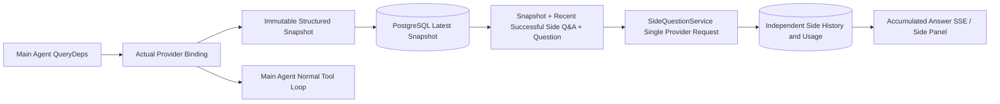

# ARTEX `/btw`

Regular chat, task MainAgent, and the current task's own Worker support independent side-channel questions. Enter `/btw question` in the main input box to submit; an empty `/btw` or the "Side Question" button opens the history. Desktop uses a resizable sidebar, mobile uses a Drawer.

Side-channel answers are generated from the Agent context snapshot at submission time, supporting streaming display, follow-up questions, stop, and clear. Closing the panel, refreshing the page, or disconnecting SSE does not cancel the model request. Stop only affects the current side-channel; clear cancels the side-channel and deletes side-channel history while retaining the main context snapshot.

## Implementation Boundaries

Uses Go, norma v0.3.7, Next.js, and existing Markdown / ResizablePanel / Drawer / AlertDialog components; no modifications to norma source code or new dependencies added for side-channel. Planner, Workers inherited from other tasks, and tool-type subtask upgrades are out of scope.

- `capture.go` only marks main-loop requests at `Options.Deps.CallModel / CallModelSync`. The provider decorator sits inside the concrete model, after the routing pool's outer selection, so it records the actually selected model; compaction and summary requests do not overwrite the snapshot.
- A snapshot is published at request start, complete model reply, and run terminal state. A half-generated reply is not published; tool calls stay paired through norma's `MessagesForAPI`, and tool results enter the snapshot at the next main model request or run terminal state. Stream abort retains the last valid boundary.
- The snapshot deep-copies via JSON to preserve structured messages, system prompts, tool definitions, and generation parameters. Model inference does not hold the snapshot lock or a database transaction.
- `SideQuestionService` calls the concrete provider; it generates a side-channel summary first when needed, and the final answer only allows a single retry-after-reduction when the first context-over-limit error occurs and no text/tool call has been output yet. It does not create an agent session, does not connect to the tool executor, main transcript, activity stream, or task graph, and does not go through the task model switch chain. The answer retains tool definitions for compatibility with existing structured tool context; summary requests do not provide tools. Newly returned tool calls have no execution path.
- One running request per parent session, at most four per service process, with a 120-second timeout per call. Side-channel uses an independent cancel context under the service lifecycle.
- The side-channel request retains a model configuration reference and a non-sensitive identity summary; credentials are obtained from the existing configuration at request time. If the configuration is deleted, or identity fields such as model, protocol, or address change, the main Agent must be run first to update the snapshot. Tests do not change the product default model.

## Persistence and Recovery

`db/schema.sql` auto-creates `side_question_sessions` and `side_question_requests`. The former stores parent resource, latest snapshot, run number, version, and cleanup version; the latter stores question, accumulated answer, status, model, snapshot time, usage, event ordinal, and pagination ordinal.

The parent session key uses conversation ID, or task ID + exploration ID + intent ID. Workers do not use reusable execution-slot naming.

Snapshots are merged and written per parent session, flushed at most every 250 ms, with the database comparing `(run_id, version)` to prevent old versions from overwriting. The selected snapshot is saved again before side-channel submission. After a successful save, the large in-memory snapshot is released; on failure, the pending version is retained. Accumulated answer content is written at most every 250 ms as streaming events arrive, with terminal state saved immediately and a limited retry on database error.

On service startup, leftover `running` requests are marked `interrupted`, retaining the already-persisted partial answers and usage, without automatically replaying requests. The most recently successfully saved context can be used directly for the next question. Old sessions without a snapshot require running the main Agent first; context is not reconstructed from UI activity records.

The clear operation increments the cleanup version and deletes requests; a conditional update prevents late callbacks from writing back. Physical parent resource deletion relies on foreign-key cascade; Worker logical deletion deletes side-channel data in the same transaction and rejects subsequent late snapshots. Task archiving first blocks new requests, waits for the main flow to stop, cancels and waits for side-channel persistence; the archive format is v3, backward-compatible with v1/v2 that do not contain side-channel tables.

History is fully preserved, returning at most 20 items per page by ordinal cursor. Model requests replay at most the 20 most recent successful Q&A pairs in original text, while limiting replay by token budget; older Q&A maintains an independent rolling summary. When the main context exceeds budget, only the old portion of the side-channel copy is summarized, retaining recent structured tool calls and results. Summary, preparation progress, and usage are all subject to the side-channel's concurrency, cancellation, and 120-second timeout limits. See [Context Budget and Open-Source References](CONTEXT_BUDGET.md).

## HTTP Contract

The following paths serve as `{parent}`, reusing existing authentication and resource validation:

- `/api/conversations/{id}`
- `/api/tasks/{id}/chat`
- `/api/tasks/{id}/intents/{iid}`

| Request | Response and Behavior |
| --- | --- |
| `GET {parent}/side-questions?before={ordinal}` | `items` newest-first, independent `current` run status, `snapshot` metadata, `next_cursor`; cursor 0 means latest page / no next page |
| `POST {parent}/side-questions` | JSON `{ "question": "…", "client_request_id": "UUID" }`; new request returns 202 with the request object; same ID and question returns existing object 200 |
| `DELETE {parent}/side-questions` | Cancel and clear the current parent session's side-channel Q&A |
| `GET /api/side-questions/{requestID}/events` | `snapshot` SSE events, `id` is an incrementing ordinal, `data` is the full accumulated request object; sends `cleared` on clear |
| `POST /api/side-questions/{requestID}/cancel` | Explicit cancel; terminal state readable from history or SSE |

Question limit is 4000 characters. No snapshot, model configuration change, same parent session busy, or idempotent ID conflict returns 409; global concurrency limit returns 429. Each SSE connection sends the accumulated state first, not relying on text fragments the client may have previously received. The frontend merges by request ID + ordinal, and discards old callbacks when switching parent sessions or clearing.

## Validation and References

Automated checks, actual model usage, and known limitations are in [VALIDATION.md](VALIDATION.md).

For the standalone request approach, see [Grok CLI side-question.ts (pinned commit)](https://github.com/superagent-ai/grok-cli/blob/fb97af83f06dca873281d60168430f06c8de6324/src/utils/side-question.ts); for runtime isolation, see [OpenCode (pinned commit)](https://github.com/anomalyco/opencode/tree/b3f1a96c6dd7adeb28b36dd11add1998fc84d67b). ARTEX's context uses norma's structured messages, not the approach of concatenating text from frontend logs.