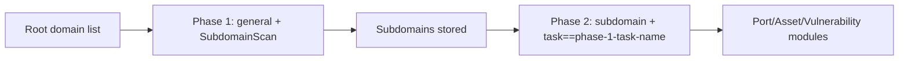

# ScopeSentry MCP User Guide

For users with an **already-deployed ScopeSentry instance**. Connect to the platform via Cursor (or another MCP client); no local source code required.

## 1. Preparation

### 1.1 Confirm the Service Is Accessible

- Default web interface: `http://<host>`
- MCP endpoint: `http://<host>/mcp` (if there is a reverse proxy or front-end proxy in front, use the actual `/mcp` address)

### 1.2 Create an API Key

1. Log in to the ScopeSentry web interface in your browser
2. Go to the **API Key** management page to create a key (or create one via an admin-provided interface)
3. Save the returned `ssk_...` string (**shown only once**)

### 1.3 Configure Cursor MCP

Cursor → Settings → MCP → add a server:

```json
{
  "mcpServers": {
    "scopesentry": {
      "url": "http://<your-host>:8082/mcp",
      "headers": {
        "X-API-Key": "ssk_your-key"
      }
    }
  }
}
```

Alternatively use: `Authorization: Bearer ssk_your-key`

After configuration, restart MCP or reload Cursor, and confirm that tools such as `list_projects`, `list_assets` appear in the tool list.

---

## 2. Tool Overview


| Tool                    | Purpose                         |
| ---------------------- | ------------------------------ |
| `list_projects`        | Project tree grouped by tag (includes project IDs) |
| `list_projects_data`   | Paginated project list, searchable by name |
| `get_project`          | Project details                |
| `create_project`       | Create a new project           |
| `list_tasks`           | Scan task list                 |
| `get_task`             | Task details                   |
| `list_scan_templates`  | Scan template list             |
| `get_scan_template`    | Template details               |
| `list_plugin_modules`  | Scan pipeline module names     |
| `list_plugins`         | Available plugins (includes hash, default params) |
| `create_scan_template` | Create a scan template         |
| `create_scan_task`     | Create a scan task             |
| `list_assets`          | Query various asset types (paginated list) |
| `count_assets`         | Count assets (`/api/assets/common/total`) |
| `get_asset_detail`     | Asset or vulnerability details |
| `add_asset_tag`        | Add a tag to an asset          |
| `list_nodes`           | Scan node list                 |


Refer to the MCP tool description (schema) for each tool's parameters; `list_assets` / `count_assets` share the same search and filter syntax, so you can read the `list_assets` description first before querying assets.

Use `count_assets` (corresponds to the web pagination total-count endpoint) when you need to know "how many in total", instead of repeatedly paging through `list_assets` just to count.

---

## 3. Common Workflows

### 3.1 Query Assets by Project

When the user or context **already has a project condition**, prioritize adding `filter.project` to narrow the scope and avoid slow responses from too much cross-project data. If no specific project is specified, project filtering is not mandatory.

1. `list_projects` or `list_projects_data` to get the target project's **ObjectID** (`id` / `children[].value`)
2. `list_assets` with `filter.project` (**must be an ID, not the project display name**)

```json
{
  "asset_type": "asset",
  "pageIndex": 1,
  "pageSize": 20,
  "search": "domain=^example.com",
  "filter": {
    "project": ["<project-ObjectID>"]
  }
}
```

### 3.2 Create a Scan Task

1. `list_nodes` to get online node names
2. `list_scan_templates` or `create_scan_template` to get a template **ObjectID**
3. `create_scan_task`: `name` and `node` are required, `template` takes a template ID (not a template name)

**Target source `targetSource` (consistent with the web UI):**

| targetSource | Description | Required Parameters |
| --- | --- | --- |
| `general` | Direct target input | `target` |
| `project` | Read targets from a project | `project` (project ObjectID array) |
| `asset` | Search from web asset library | `search`; optional `project`, `filter`, `targetNumber` |
| `RootDomain` | Search from root domain library | `search`; optional `project`, `filter`, `targetNumber` |
| `subdomain` | Search from subdomain library | `search`; optional `project`, `filter`, `targetNumber` |
| `UrlScan` | Search from URL scan results | `search`; optional `project`, `filter`, `targetNumber` |
| `*Source` (e.g. `subdomainSource`) | Created from asset page "select/search" | Use `search` when `targetTp=search`; use `targetIds` when `targetTp=select` |

**Example — scan root domains directly:**

```json
{
  "name": "example-subdomain-collection",
  "node": ["node-1"],
  "template": "<template-ObjectID>",
  "targetSource": "general",
  "target": "example.com\nfoo.com",
  "project": ["<project-ObjectID>"]
}
```

**Example — continue scanning from the subdomain library (filter by previous task name):**

```json
{
  "name": "example-port-and-vulnerability",
  "node": ["node-1"],
  "template": "<follow-up-module-template-ObjectID>",
  "targetSource": "subdomain",
  "search": "task==\"example-subdomain-collection\"",
  "project": ["<project-ObjectID>"]
}
```

### 3.3 Full Root Domain Recon (Recommended Two-Phase Approach)

When the input is a **root domain** and you want to perform **full reconnaissance**, it is recommended to split into two scans rather than running the entire pipeline at once.

**Reason:** Distributed tasks are dispatched per **individual target**. When a root domain is the target, the node assigned that root domain will also continue running subsequent modules for subdomains discovered on that node, easily causing uneven load, slow speed, and errors.

**Best Practice:**

1. **Phase 1 — Subdomain Collection Only**
   - `targetSource`: `general`
   - `target`: all root domains (multiple lines)
   - Template: enable only `SubdomainScan`, `SubdomainSecurity` (subdomain scan + subdomain takeover)
   - Use `get_task` to wait for the task to complete

2. **Phase 2 — Follow-Up Modules**
   - `targetSource`: `subdomain`
   - `search`: `task=="<phase-1-task-name>"` (exact match on task name)
   - Optional `project` to narrow the scope
   - Template: port scan, asset mapping, vulnerability scan, etc. (can omit SubdomainScan)
   - Subdomains are distributed as independent targets across nodes, improving parallel efficiency

You can also filter by task name on the web UI "Subdomain" asset page and use "Create task from subdomains", which achieves the same result.



### 3.4 Create a Scan Template

1. `list_plugin_modules` → module name list
2. `list_plugins` (can filter by `module`) → each plugin's `hash` and default `parameter`
3. `create_scan_template`: use `modules` to specify "module → plugin hash array"

---

## 4. Asset Query (`list_assets` / `count_assets`)

`count_assets` uses the same `asset_type`, `search`, and `filter` as `list_assets`, and returns `{ "total": N }`, corresponding to the web endpoint `/api/assets/common/total`.

```json
{
  "asset_type": "subdomain",
  "search": "task==\"some-task-name\"",
  "filter": {"project": ["<project-ObjectID>"]}
}
```

**Performance Tips (common to `list_assets` / `count_assets`):** When you have a project condition, prioritize using `filter.project` to narrow the scope; for indexed fields in `search`, try to use `==` exact match or `^` prefix match (see [4.3](#43-search-expression)), and avoid large-scale `=` fuzzy queries that slow down responses. When there is no project context, project filtering is not mandatory.

For types that support `filter.project`, see the table in [4.4](#44-filter-exact-filtering).

### 4.1 Asset Types `asset_type`

`asset`, `RootDomain`, `subdomain`, `app`, `mp`, `UrlScan`, `SensitiveResult`, `DirScanResult`, `crawler`, `vulnerability`, `PageMonitoring`, `IPAsset`, `SubdomainTakerResult`

Alias examples: `web`→asset, `vuln`→vulnerability, `ip`→IPAsset, `url`→UrlScan

### 4.2 Parameter Description


| Parameter                 | Description                                |
| ------------------------ | ----------------------------------------- |
| `pageIndex` / `pageSize` | Pagination, defaults 1 / 20               |
| `search`                 | Search expression (see next section)      |
| `filter`                 | Exact filter JSON (see next section)      |
| `sort`                   | Only UrlScan, DirScanResult support sorting by `length` |
| `sid`                    | Only SensitiveResult: sensitive rule name |


`search` and `filter` **can be used together**.

### 4.3 search Expression

Custom DSL (**not SQL**):


| Operator | Meaning             | Index    | Example                      |
| ---- | ---- | ---- | --------------------------- |
| `=`  | Fuzzy match (regex) | No index | `domain=example`            |
| `==` | Exact match         | **Indexed** | `port==443`                 |
| `!=` | Exclude             | — | `port!="80"`                |
| `&&` | AND                 | — | `domain==example.com && port==443` |
| `||` | OR                  | — | `title=admin || body=login` |


**Index and Operators:** Fields like `domain`, `ip`, `port`, `title` are indexed, but only **`==` exact match** or **prefix match where the value starts with `^`** (e.g. `domain=^example.com`) can use the index; **`=` converts to a regex fuzzy match and cannot use the index**, which can be slow with large data volumes.

**Common search fields for all types:** `tag`, `task` (task name), `rootDomain`

**project cannot be written in search** (ineffective or errors when combined with `&&`). To filter by project, use `filter.project`.

**Common search fields by type:**


| asset_type           | Fields                                                                               |
| -------------------- | ----------------------------------------------------------------------------------- |
| asset                | domain, ip, port, service, app, title, statuscode, icon, banner, type, body, header |
| RootDomain           | domain, icp, company                                                                |
| subdomain            | domain, ip, type, value                                                             |
| app                  | name, icp, company, category, description, url, apk                                 |
| mp                   | name, icp, company, category, description, url                                      |
| UrlScan              | url, input, source, resultId, type                                                  |
| SensitiveResult      | url, sname, body, info, md5                                                         |
| DirScanResult        | url, statuscode, redirect, length                                                   |
| vulnerability        | url, vulname, matched, request, response, level                                     |
| crawler              | url, method, body, resultId                                                         |
| PageMonitoring       | url, hash, diff, response                                                           |
| IPAsset              | ip, domain, port, service, webServer, app                                           |
| SubdomainTakerResult | domain, value, type, response                                                       |


**search examples:**

- `domain==www.example.com && port==443` (exact match, indexed)
- `domain=^example.com` (prefix match, indexed)
- `ip==192.168.1.1`
- `task=="some-task-name"`
- `level==high` (vulnerability)
- `statuscode==200` (DirScanResult)

Use `=` only when you need a fuzzy contains match, e.g. `title=admin` (not indexed, best combined with project or other conditions to narrow the scope).

### 4.4 filter Exact Filtering

JSON object: multiple values for the same key are **OR**, different keys are **AND**.

**Prioritize `project` when you have a project condition:** If the user or context already specifies a project and the asset_type supports `project`, include it to narrow the scope; when there is no project information, it is not mandatory.


| filter key   | Meaning      | Value Notes                                              |
| ------------ | ----------- | -------------------------------------------------------- |
| `project`    | Project     | **ObjectID**, obtain via `list_projects` / `list_projects_data` |
| `task`       | Source task | **Task name**, from `list_tasks` `name`                  |
| `port`       | Port        | e.g. `"443"`                                             |
| `service`    | Service/protocol | e.g. `"https"`                                      |
| `app`        | App fingerprint | e.g. `"Nginx"`                                      |
| `icon`       | Icon hash   |                                                          |
| `statuscode` | HTTP status code | Mainly for asset                                    |
| `status`     | Status      | UrlScan/DirScan HTTP code; vulnerability/sensitive info processing status |
| `level`      | Vulnerability severity | critical / high / medium / low / info          |
| `type`       | Type        | e.g. subdomain record type A, CNAME                     |
| `color`      | Sensitive rule color | SensitiveResult                                   |
| `sname`      | Sensitive rule name | SensitiveResult                                   |
| `tags`       | Tags        |                                                          |


**Available filter keys by type:**


| asset_type                            | filter key                                                      |
| ------------------------------------- | --------------------------------------------------------------- |
| asset                                 | project, port, service, app, icon, statuscode, type, task, tags |
| RootDomain                            | project, tags                                                   |
| subdomain                             | project, type, task, tags                                       |
| app / mp                              | project, tags                                                   |
| UrlScan                               | status, tags                                                    |
| DirScanResult                         | status, tags                                                    |
| SensitiveResult                       | status, color, sname, tags                                      |
| crawler                               | project, task, tags                                             |
| vulnerability                         | project, level, status, task, tags                              |
| PageMonitoring / SubdomainTakerResult | tags                                                            |
| IPAsset                               | project, port, service, app                                     |


**filter example:**

```json
{"project": ["<project-ObjectID>"], "port": ["443"]}
```

**Combined query example:**

```json
{
  "asset_type": "asset",
  "search": "domain=^baidu && port==443",
  "filter": {"project": ["<project-ObjectID>"]},
  "pageIndex": 1,
  "pageSize": 10
}
```

**Notes:**

- When you have a project condition, prioritize `filter.project` (if supported); without project context, it is not mandatory
- Do not put the project display name in `filter.project`
- Use `==` for known values, `^` for prefixes; avoid excessive `=` fuzzy matching on large tables
- For UrlScan HTTP status, use `filter.status`; for DirScanResult, you can use `statuscode==200` in search
- For SensitiveResult by rule name: use `sname=rule-name` in `search`, or `filter.sname`

### 4.5 Sorting sort

Only **UrlScan** and **DirScanResult** support:

```json
{"length": "ascending"}
```

Other types ignore `sort` and default to time-based ordering.

---

## 5. Scan Template Module Names

`TargetHandler`, `SubdomainScan`, `SubdomainSecurity`, `PortScanPreparation`, `PortScan`, `PortFingerprint`, `AssetMapping`, `AssetHandle`, `URLScan`, `WebCrawler`, `URLSecurity`, `DirScan`, `VulnerabilityScan`, `PassiveScan`

---

## 6. Troubleshooting


| Symptom             | Resolution                                                        |
| ------------------- | ---------------------------------------------------------------- |
| MCP has no tools    | Check URL, API Key, and whether ScopeSentry is running           |
| 401 / 403           | Recreate or replace the API Key                                  |
| Assets not found    | Confirm `filter.project` is an ObjectID; do not put project in search |
| Template/task creation failed | `template` must be a template ObjectID; `node` must be an online node name |
| Query very slow/stuck | Add `filter.project` when you have a project; for indexed fields in search, use `==` or `^` prefix instead of `=`; reduce `pageSize` |


---
